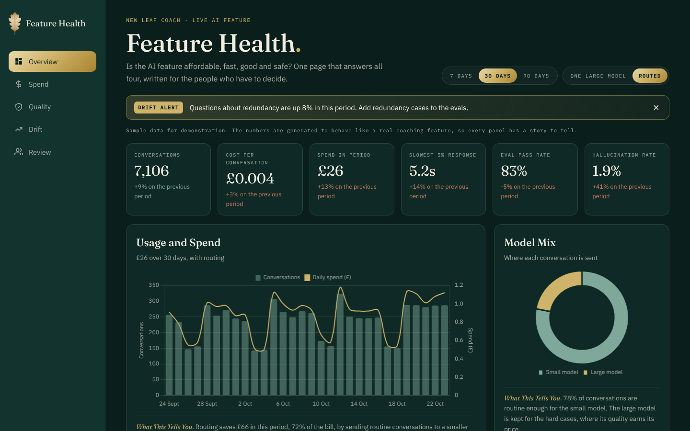
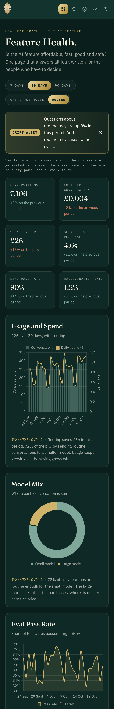

<p align="center"></p>

# AI Feature Health Dashboard

[](https://github.com/elleanderson/ai-feature-health-dashboard/actions/workflows/deploy.yml)


**[Open the live dashboard](https://elleanderson.github.io/ai-feature-health-dashboard/)**

A one-page dashboard that answers the four questions every leader should ask about a live AI feature. Is it affordable? Is it fast? Is it good? Is it safe?



## Why This Exists

Most AI dashboards are built for engineers. They're full of token counts and request logs, and they leave the people who fund the feature guessing.

This one is built for the product leader, the finance partner and the board. Every panel ends with a short **What This Tells You** note in plain English, so the chart leads to a decision rather than a shrug. It's the companion to my [AI Glossary for Product Leaders](https://andersonco.uk/ai-glossary), where LLMOps, evals, model drift and unit economics are explained term by term.

The example feature is a version of the coach inside [New Leaf](https://andersonco.uk/newleaf), my free career story tool. The quality panels pair naturally with [AI Coach Evals](https://github.com/elleanderson/ai-coach-evals), the eval kit I use to test it.

## What's on the Page

| Panel | The Question It Answers |
|---|---|
| Headline measures | Conversations, cost per conversation, spend, the slowest 5% of response times, eval pass rate and hallucination rate, each compared with the previous period |
| Usage and Spend | How usage and the bill move together, day by day |
| Model Mix | How much routing routine work to a smaller model saves |
| Eval Pass Rate | Whether quality is holding, and what happened after the last prompt change |
| Hallucination Rate | How often replies contain an invented claim, against an agreed limit |
| Response Time | Whether the slow tail is creeping past the target |
| What People Ask About | Whether real usage is drifting away from what the feature was tuned for |
| Human Review Queue | What a person has checked, and why |

Two controls change every panel at once:

- **7, 30 or 90 days**, compared with the period before
- **One Large Model or Routed**, which recalculates the whole cost picture so you can see the saving routing would bring

A drift alert sits at the top and can be dismissed, as a real alert would.

## About the Data

The numbers are generated, not real usage, and the page says so. They're shaped to behave like a live coaching feature, with weekday peaks, steady growth, a slow drift towards redundancy questions and a short quality dip after a prompt edit. A seeded random generator means everyone sees the same story. Prices are illustrative and don't belong to any vendor's price list.

## Built With

- **TypeScript** in strict mode, with typed data, cost and formatting modules
- **SCSS** organised into tokens, base, layout and component partials, sharing the brand colours of [andersonco.uk](https://andersonco.uk)
- **Chart.js 4** for bar, line, doughnut and horizontal bar charts, registered tree-shakeably
- **CSS Grid and Flexbox** for a layout that works at phone, tablet and desktop widths
- **Inline SVG** icons for the navigation
- **Vite** for the development server and production build
- **GitHub Actions** to type check, build and deploy to **GitHub Pages** on every push

```
src/
├── data.ts            sample data generator, cost model and targets
├── format.ts          British currency, number, date and change formatting
├── main.ts            charts, headline measures, controls and notes
└── styles/
    ├── _tokens.scss   brand colours, fonts, breakpoints and mixins
    ├── _base.scss
    ├── _layout.scss
    └── components/    controls, alert, kpi, panel and table
```

## Running It Locally

You'll need Node.js 18 or later.

```bash
git clone https://github.com/elleanderson/ai-feature-health-dashboard.git
cd ai-feature-health-dashboard
npm install
npm run dev        # development server with hot reload
npm run build      # type check and production build into dist/
```

## On a Phone



## About Me

I'm [Elle Anderson](https://andersonco.uk), a product leader and executive coach (Fellow, Chartered Institute for IT). I help senior teams turn AI from a slide into a product decision, with the evidence, guardrails and economics to back it. If you'd like a dashboard like this for your own AI features, you can [book a consultation](https://andersonco.uk/book).

## Licence

MIT. Use it, adapt it and build on it.
